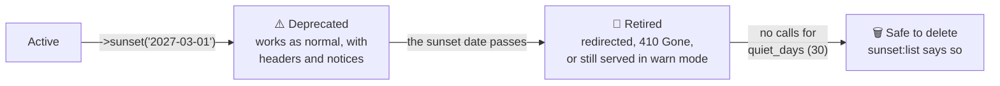
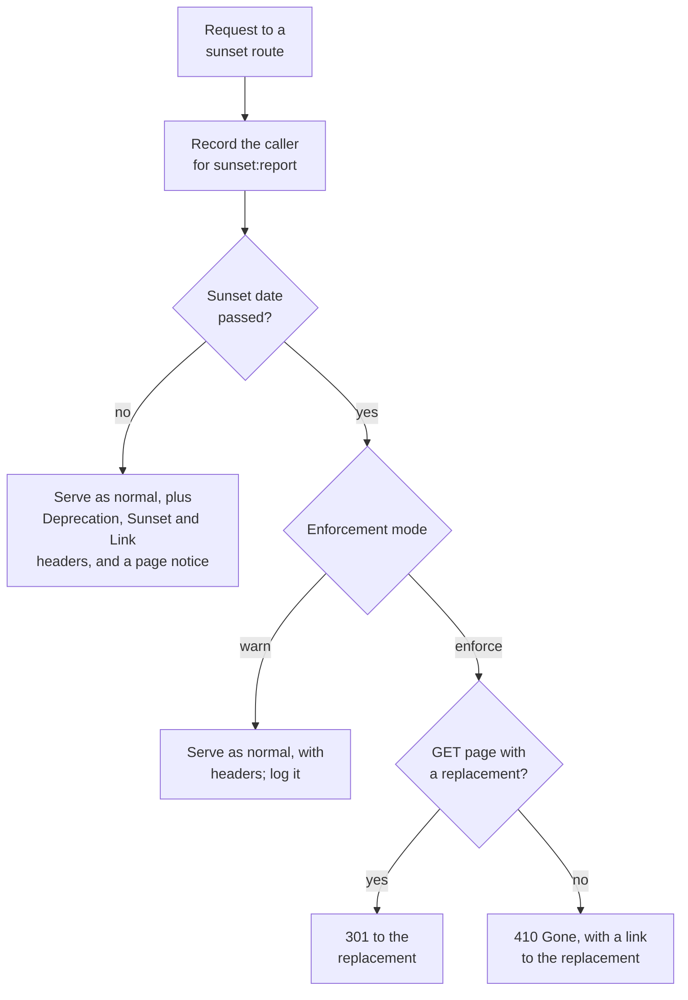
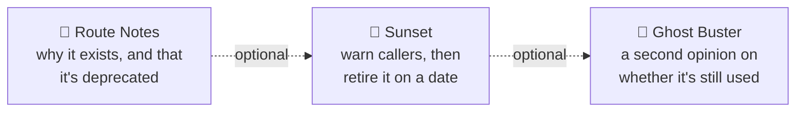

<h1 align="center">🌅 Sunset</h1>

<p align="center">
    <strong>Retire old routes in your Laravel app without breaking the people still using them.</strong><br>
    Give a route a sunset date, warn its callers with standard headers and in-page notices,<br>
    see exactly who's still calling it, then redirect or switch it off when the day comes.
</p>

<p align="center">
    <a href="https://github.com/Jarryd-W-Hoffman/sunset/actions/workflows/tests.yml"></a>
    
    
    
</p>

> [!NOTE]
> **🚧 In progress.** This README is the spec. Built so far: scheduling a sunset with `->sunset()` or `#[Sunset]`, with validation, and `route:cache` support. Headers, enforcement, caller reports and the commands are next. Screenshots will be added as the commands land.

<p align="center">
    <a href="#why-sunset">Why Sunset?</a> ·
    <a href="#how-it-works">How it works</a> ·
    <a href="#features">Features</a> ·
    <a href="#installation">Installation</a> ·
    <a href="#commands">Commands</a> ·
    <a href="#configuration">Configuration</a> ·
    <a href="#what-gets-stored">What gets stored</a> ·
    <a href="#works-with-route-notes-and-ghost-buster">Route Notes and Ghost Buster</a> ·
    <a href="#development">Development</a> ·
    <a href="#license">License</a>
</p>

---

## Why Sunset?

- **One route at a time.** No versioning scheme to adopt and no `/v1` to `/v2` restructure. Add `->sunset('2027-03-01')` to the route you want gone, and leave the rest of your app as it is.
- **Web pages too, not just APIs.** Browsers ignore deprecation headers, so Sunset can show a notice on the page and, after the date, redirect visitors to the page that replaced it.
- **Know who to tell.** `sunset:report` lists who still calls each retiring route (which users, API tokens or clients), so you can contact them before the date instead of after something breaks.
- **Safe by default.** Nothing is switched off until you say so: start in `warn` mode, watch the report, then enforce.

## How it works

A route moves through four stages. Sunset handles all of them on its own: it records every call to a sunset route, so it knows when a retired route has gone quiet and is safe to delete.



On every request to a sunset route:



## Features

### 🗓️ Scheduling a sunset

- **On the route:**

  ```php
  Route::get('/reports/legacy', [ReportController::class, 'legacy'])
      ->name('reports.legacy')
      ->sunset('2027-03-01', replacement: 'reports.index');

  Route::post('/api/v1/orders', [OrderController::class, 'storeV1'])
      ->sunset('2027-06-30', since: '2026-11-01', replacement: 'api.v2.orders.store', reason: 'Use the v2 orders API');
  ```

- **Or on the controller**, as an attribute on a method or the whole class:

  ```php
  use Jarryd\Sunset\Sunset;

  #[Sunset('2027-03-01', replacement: 'reports.index')]
  public function legacy() { /* ... */ }
  ```

- **Options:**
  - `date` (required): the day the route is retired, at midnight in your app's timezone.
  - `replacement`: a route name or URL. It's validated, so a typo fails `sunset:check` instead of sending people nowhere.
  - `since`: when the deprecation was announced. Sent as the `Deprecation` header (RFC 9745); omit it and only the `Sunset` header is sent.
  - `reason`: a sentence for people: shown in page notices, `410` responses and the reports.
  - `mode`: override the global `warn` / `enforce` setting for this route.
- **Survives `route:cache`:** like Route Notes, everything is stored in the route action as plain data.

### 📣 Warning callers (before the date)

- **Standard headers** on every response, so well-behaved API clients and tools pick it up:

  ```http
  Deprecation: @1793491200
  Sunset: Wed, 30 Jun 2027 00:00:00 GMT
  Link: <https://acme.test/api/v2/orders>; rel="successor-version"
  ```

- **Page notices** for people in a browser: drop `<x-sunset::notice />` into your layout and it shows on sunset pages only ("This page is being retired on 1 March 2027. Use Reports instead."). For Inertia or Livewire, read the same data from `Sunset::current()`.
- **An event**, `DeprecatedRouteCalled`, at most once per caller per day, for Slack alerts or anything else.

### 🚪 Retiring (after the date)

- **`warn` mode (default):** keep serving the route, with the headers, and log each call. Nothing ever breaks on its own.
- **Switch to `enforce` when you're ready**, for every route at once in `config/sunset.php` or with the `SUNSET_MODE` env variable:

  ```php
  'mode' => env('SUNSET_MODE', 'warn'), // or 'enforce'
  ```

  Or for a single route, with `->sunset('2027-03-01', mode: 'enforce')`. A route's own mode wins over the config.
- **`enforce` mode:**
  - `GET` and `HEAD` page requests with a replacement get a **`301` redirect** to it, so old bookmarks and search results keep working.
  - Everything else gets **`410 Gone`**, with the reason and a link to the replacement, as JSON for API requests or a simple page for browsers.
  - Non-`GET` requests are never redirected: replaying a `POST` against a different endpoint isn't safe.
- **A grace period** (`grace_days`) lets you enforce a few days late without changing every date.

### 🔎 Seeing who's still calling

- **Every call is recorded** against the route, before and after the date, including blocked ones.
- **Callers are identified** by the signed-in user (`user:42`), else the Sanctum token's name (`token:mobile-app`), else the client's user agent family (`agent:okhttp`). Swap in your own with `Sunset::identifyCallersUsing(fn (Request $request) => ...)`.
- **No IP addresses by default.** They're personal data in most places; opt in if you need them.

## Installation

### Requirements

- **PHP** 8.3+
- **Laravel** 12 or 13

### Install

```bash
composer require jarryd/sunset
php artisan migrate
```

Sunset's middleware is added to your `web` and `api` groups. Routes using `->sunset()` get it automatically wherever they're defined; routes using the `#[Sunset]` attribute outside those groups need `->middleware('sunset')`.

To change the defaults, publish the config file:

```bash
php artisan vendor:publish --tag="sunset-config"
```

## Commands

| Command | What it does |
| --- | --- |
| `php artisan sunset:list` | Every sunset route: its date, days left, stage, replacement and how many callers it still has |
| `php artisan sunset:report` | Who's still calling each sunset route, busiest first, with hits and when they last called |
| `php artisan sunset:report reports.legacy` | The callers of one route |
| `php artisan sunset:report --since=7` | Only callers seen in the last 7 days |
| `php artisan sunset:check` | For CI: fails on a replacement that doesn't exist, or on a route past its date that's been quiet long enough to delete |
| `--json` | On `sunset:list` and `sunset:report`, for scripts and dashboards |

## Configuration

All options live in `config/sunset.php`:

| Option | Default | What it does |
| --- | --- | --- |
| `mode` | `warn` | What happens after the date: `warn` keeps serving with headers and logging; `enforce` redirects or returns `410`. Env: `SUNSET_MODE`. |
| `grace_days` | `0` | Days after the sunset date before `enforce` mode kicks in. |
| `quiet_days` | `30` | Days without calls before `sunset:list` and `sunset:check` call a retired route safe to delete. |
| `middleware_groups` | `['web', 'api']` | Groups the middleware is added to. |
| `record_calls` | `true` | Record callers for `sunset:report`. |
| `record_ip` | `false` | Also record the caller's IP address. |
| `notice_view` | `sunset::notice` | The Blade view for page notices, if you want your own. |

## What gets stored

One table, `sunset_calls`, with one row per route, method and caller:

| Column | Example | Notes |
| --- | --- | --- |
| `route` | `api.v1.orders.store` | The route name, or its URI if it has no name |
| `method` | `POST` | |
| `caller` | `token:mobile-app` | See [Seeing who's still calling](#-seeing-whos-still-calling) |
| `hits` | `1,204` | Calls recorded, blocked ones included |
| `first_called_at` / `last_called_at` | `2026-11-02 09:14:00` | |

The sunset dates themselves live in your route definitions, not the database, so they're reviewed in pull requests like any other change.

## Works with Route Notes and Ghost Buster

**Sunset is fully standalone.** It doesn't require either package. Everything above, including "safe to delete", comes from Sunset's own `sunset_calls` table. Route Notes and Ghost Buster are listed under `suggest` in `composer.json`, not `require`. When Sunset finds one of them installed, it adds a few extras, and nothing changes when they're absent.

The three packages each cover one step of a route's retirement:



| If installed | Sunset adds |
| --- | --- |
| [Route Notes](https://github.com/Jarryd-W-Hoffman/route-notes) | `->sunset()` also adds a `deprecated` note, so `route:list` shows "Sunset on 1 Mar 2027, use reports.index" beneath the route. `sunset:list --candidates` lists routes with a `deprecated` note but no sunset date yet. |
| [Ghost Buster](https://github.com/Jarryd-W-Hoffman/ghost-buster) | `sunset:list` shows Ghost Buster's last-used time and hit count beside each route. These cover the route's life *before* it was given a sunset date. |

These are one-way and read-only: Sunset reads from the other packages when it finds them, and never the other way round. Neither of them needs to know Sunset exists.

## Development

```bash
composer test         # run the test suite
```

| Command | What it does |
| --- | --- |
| `composer test` | Run every test |
| `vendor/bin/phpunit --filter=…` | Run some of the tests |
| `composer lint` | Check code style (Pint) |
| `composer format` | Fix code style |
| `composer analyse` | Static analysis of `src` (PHPStan level 8, with Larastan) |
| `composer analyse:tests` | Static analysis of the tests |

CI runs the lint and static analysis, then the suite on PHP 8.3, 8.4 and 8.5 against Laravel 12 and 13, without Route Notes or Ghost Buster installed, so Sunset is always tested on its own. Once the integrations exist, one more job will install both and run their tests.

### Contributing

Pull requests are welcome.
- Work on a feature branch and keep commits small.
- Sign off every commit (`git commit -s`): the repository checks the [Developer Certificate of Origin](https://developercertificate.org).
- Each change comes with tests, and `composer test` should pass before you open a PR.

## License

Sunset is open-source software licensed under the [MIT license](LICENSE).
